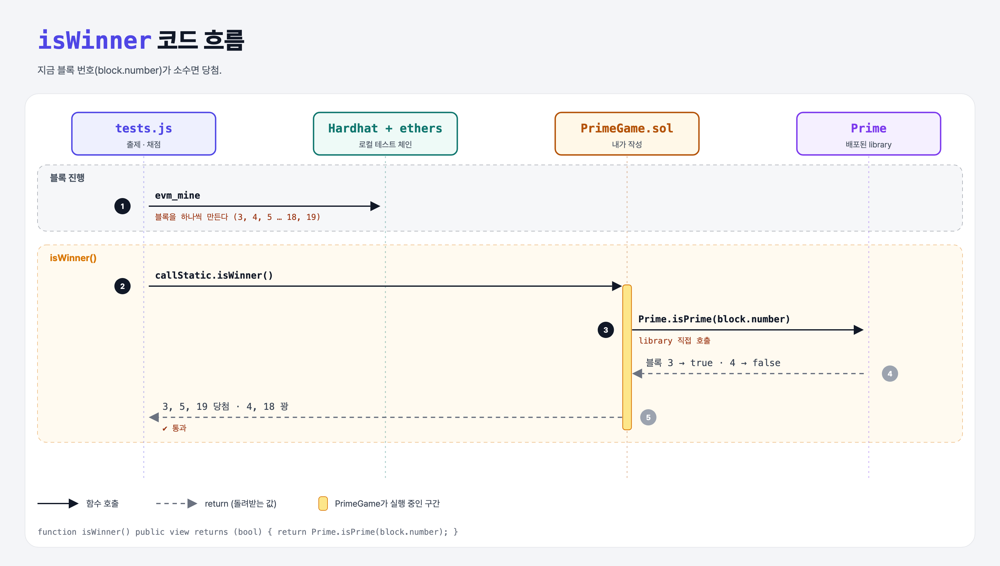

# Prime Block Winner (Libraries 6단계)

## 문제

`PrimeGame` 컨트랙트에 `isWinner()`: 현재 블록 번호가 소수면 `true`.

## 한 줄 요약

`return Prime.isPrime(block.number);`



---

## 0. 이 과제가 말하려는 것

> **전역 변수 `block`으로 현재 블록 정보를 읽을 수 있다.**

| 값 | 뜻 |
|----|----|
| `block.number` | 블록 번호 |
| `block.timestamp` | 블록 시각 (초) |
| `block.coinbase` | 블록을 만든 주소 |
| `block.gaslimit` | 블록 가스 한도 |

block 값은 채굴자/검증자가 어느 정도 고를 수 있어서 진짜 복권의 난수로 쓰면 안 된다. 이 문제는 연습용.

---

## 1. 파일 구성

| 파일 | 역할 |
|------|------|
| `PrimeGame.sol` | **이번에 완성할 컨트랙트** |
| `Prime.sol` | 5단계 library |
| `tests.js` | 출제 · 채점 (테스트 5개) |

---

## 2. 정답 코드

```solidity
import "./Prime.sol";

contract PrimeGame {
    function isWinner() public view returns (bool) {
        return Prime.isPrime(block.number);
    }
}
```

`block.number`를 읽으니 `pure`가 아니라 `view`.

---

## 3. 테스트 한 줄씩

```js
const mineBlock = () => ethers.provider.send("evm_mine");   // 빈 블록 하나 만들기
// 블록 0, 1, 2는 배포에 쓰임 → mineBlock() 후 블록 3: 당첨
// 4: 꽝, 5: 당첨, 18: 꽝, 19: 당첨
const isWinner = await contract.callStatic.isWinner();
```

---

## 5. 실행 방법

```bash
sh tools/sol-test.sh week7/library-prime-game
```

## 로컬 실행 환경 메모

강의 사이트는 브라우저 안에서 Hardhat으로 컴파일·테스트한다. 로컬에서는 루트의 Hardhat(ethers v5)으로 똑같이 돌린다: `sh tools/sol-test.sh <폴더>`.

## 기억할 것

1. `block.number`, `block.timestamp`.
2. 상태를 읽으면 `view`, 아무것도 안 읽으면 `pure`.
