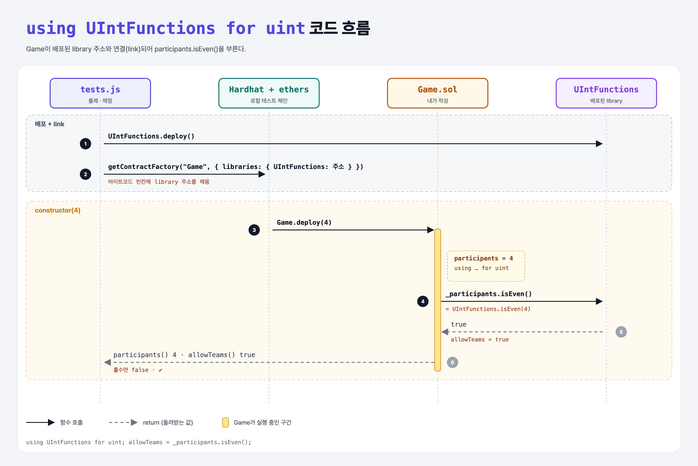

# Using Library (Libraries 2단계)

## 문제

`Game` 컨트랙트에 constructor를 만든다.

1. `uint` 참가자 수를 받아 `participants`에 저장한다.
2. 참가자 수가 짝수일 때만 `allowTeams = true`.

## 한 줄 요약

`using UIntFunctions for uint;` 를 선언하고 `allowTeams = _participants.isEven();`



---

## 0. 이 과제가 말하려는 것

> **library 함수를 부르는 두 가지 방법.**

| 방법 | 코드 |
|------|------|
| 직접 호출 | `UIntFunctions.isEven(x)` |
| `using … for` | `using UIntFunctions for uint;` 선언 후 `x.isEven()` |

`using A for uint`는 uint 값에 A의 함수를 메서드처럼 붙여 준다. 이때 `x`가 첫 번째 인자로 들어간다.

**link(연결)**: library 함수가 `public`이면 library는 따로 배포되고, Game의 바이트코드에는 그 주소가 들어갈 빈칸이 생긴다. 그래서 테스트가 `libraries: { UIntFunctions: library.address }`로 주소를 채워 준다. `internal` 함수만 있으면 Game 안에 코드가 그대로 복사되어 link가 필요 없다.

---

## 1. 파일 구성

| 파일 | 역할 |
|------|------|
| `Game.sol` | **이번에 완성할 컨트랙트** |
| `UIntFunctions.sol` | 1단계 library |
| `tests.js` | 출제 · 채점 (테스트 12개) |

---

## 2. 정답 코드

```solidity
import "./UIntFunctions.sol";

contract Game {
    using UIntFunctions for uint;

    uint public participants;
    bool public allowTeams;

    constructor(uint _participants) {
        participants = _participants;
        allowTeams = _participants.isEven();
    }
}
```

---

## 3. 테스트 한 줄씩

```js
const Contract = await ethers.getContractFactory("Game", {
    libraries: { UIntFunctions: library.address }   // 배포된 library 주소로 link
});
contract = await Contract.deploy(participants);     // 2, 4, 6 → allowTeams true / 3, 5, 7 → false
```

---

## 4. 일부러 틀려 보면

| 바꾼 것 | 결과 |
|---------|------|
| library 함수를 `public` → `internal` | Game에 코드가 복사되어 link할 library가 없어짐 → `You tried to link the contract Game with UIntFunctions, which is not one of its libraries.`로 배포 실패 (테스트 6개 실패) |

---

## 5. 실행 방법

```bash
sh tools/sol-test.sh week7/library-using
```

## 로컬 실행 환경 메모

강의 사이트는 브라우저 안에서 Hardhat으로 컴파일·테스트한다. 로컬에서는 루트의 Hardhat(ethers v5)으로 똑같이 돌린다: `sh tools/sol-test.sh <폴더>`.

## 기억할 것

1. `using L for 타입` → `값.함수()`.
2. public library 함수 = 따로 배포 + link.
